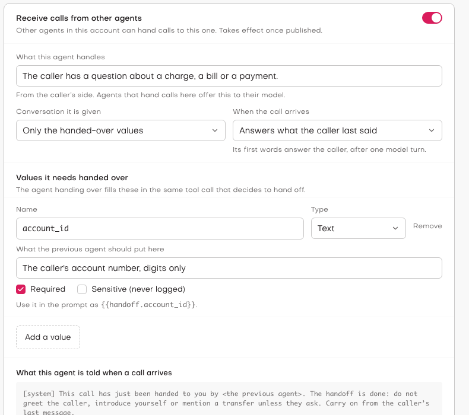
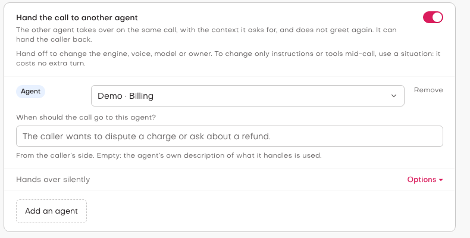
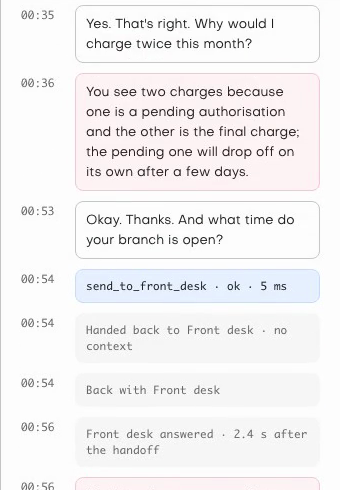

A single voice agent that does everything gets hard to build and hard to change. Its prompt grows with every
department it covers, one voice and one model have to suit every part of the call, and when the billing team wants to
change how billing calls go, they're editing the front desk's agent.

The usual alternative is a phone tree of agents: the front desk transfers the caller somewhere else. But a transfer
starts a new conversation. The caller is greeted again, asked for their account number again, and the new agent has no
idea what was just said.

Agent Studio now lets one agent **hand a call to another agent**, on the same call. The next agent gets the values it
asked for, isn't allowed to greet the caller again, and picks up from what the caller last said. It can hand the
caller back when they need something it can't help with.

## See it on a call

<!-- Replace VIDEO_ID with the YouTube id once the video is uploaded. -->
<iframe style="width: 100%; height: auto; aspect-ratio: 16 / 9;" src="https://www.youtube.com/embed/VIDEO_ID" title="Agent handoff in Agent Studio: one call, two voice agents" frameborder="0" allow="accelerometer; autoplay; clipboard-write; encrypted-media; gyroscope; picture-in-picture; web-share" referrerpolicy="strict-origin-when-cross-origin" allowfullscreen></iframe>

The call in the video, with two agents built in Studio, a front desk and a billing desk:

1. The caller asks the front desk about a charge on their bill. The front desk asks for their account number, then
   hands the call to billing, without announcing it.
2. Billing speaks 2.6 seconds later. It doesn't say hello; it reads the account number back and asks the caller to
   confirm it. Billing was given no conversation at all, only the account number, so that number can only have come
   through the handoff.
3. The caller asks why they were charged twice, and billing explains.
4. Then the caller asks what time the branches open. Billing doesn't know, so it hands the caller back to the front
   desk, which answers 2.4 seconds later, again without a second greeting.

## The receiving agent sets the terms

An agent only takes handed-over calls once you turn on **Receive calls from other agents** and publish it. On the same
card, it says what it needs:

*The billing agent asks for a required `account_id`, and takes no conversation: only the values it's handed.*

- **What this agent handles**, from the caller's side. Agents that hand calls to it offer this to their model.
- **The values it needs handed over**, such as `account_id`: each with a type, a description for the agent filling it
  in, and whether it's **required** or **sensitive** (kept out of every log and call record). Its prompt uses them as
  `{{handoff.account_id}}`.
- **How much of the conversation it gets**: a summary written by the previous agent, the last few turns, or nothing
  but the values.
- **How it opens**: by answering what the caller last said, or with a fixed line that plays as soon as its voice is
  ready.

Putting this contract on the receiving agent matters when different people own different agents. The billing team
decides what billing needs, once, and every agent that hands calls to billing is held to it.

## Handing over in the same tool call

On the agent that hands calls over, the other agent is a destination, like a phone number or another application:

*The front desk hands billing questions to the billing agent.*

Each agent destination becomes a tool for the model, `send_to_billing` here, whose parameters are the values the other
agent asked for. So the model fills in the account number in the same tool call that decides to hand off: there's no
separate step to gather what the next agent needs, and no extra model turn. The model is also told to hand off without
announcing it, because the next agent speaks straight away.

Studio checks the values against the receiving agent's **live** version when the handoff happens. If a required value
is missing, the handoff is refused, and the model is told which value to ask the caller for. The call never reaches an
agent that can't do its job.

## The same call, start to finish

The handoff doesn't redirect the call anywhere. Studio starts the next agent on the call it already holds: it gets the
note that the handoff is done, the values, and the context it asked for, while the previous agent stops. One call
record covers every agent the call went through.

That is also why a handoff can be refused safely. Studio prepares the next agent first, and only swaps once it's ready.
If anything is wrong, such as the other agent being unpublished or a value not fitting its type, the agent that tried
keeps the call, is told why, and keeps helping the caller.

A handoff to an agent that already took part in the call is a **return**. That agent runs the same version as before,
gets the whole conversation, and is told the caller is back and what they last said.

To stop agents bouncing a caller between them, a call can be handed over at most 4 times, the same pair at most twice,
and an agent can't hand the caller straight back to the agent that just handed it the call until the caller speaks.

## What you see

Each handoff is on the call's timeline, in the test console while you're testing and in the call history afterwards:
who it went to, which values were passed, how much context, and how long the next agent took to speak.

*The return in the demo call: billing calls `send_to_front_desk`, and the front desk answers 2.4 s later.*

A refused handoff shows there too, with its reason. Sensitive values never appear in any of it.

## Handoff, Situation or application?

A handoff ends one agent and starts another, so it costs two model turns back to back: the decision to hand off, and
the next agent's first reply. On our pipeline agents that came to about 2.2 to 2.6 seconds. That's worth paying when the
call needs something one agent can't change in place.

| The caller needs… | Use |
|---|---|
| Different instructions or tools, same engine and voice | a [Situation](https://jambonz.org/blog/situations-in-agent-studio) |
| A different engine, voice, speech vendor or language model | a handoff |
| An agent that another team builds and publishes | a handoff |
| A queue, an IVR, a conference or your own code | send the call to another jambonz application |

Studio points this out as you build: it warns when the agent you hand to uses the same engine, model and voice as the
one handing over, since a Situation would probably do.

## Try it

Open an agent's **Transfer & hangup** section. Turn on **Receive calls from other agents** on the agent that should
take calls, say what it needs, and publish it. Then turn on **Hand the call to another agent** on the agent that hands
calls over, choose the other agent, and start a test call from the browser.

Cascaded pipeline agents, realtime voice API agents and ElevenLabs agents can all receive handed-over calls; a
Dialogflow CES agent or a custom harness can't, because Studio can't tell them not to greet a caller who is already on
the line. The full reference is in the [Agent Studio docs](https://docs.jambonz.org/agent-studio/building/handoff).
