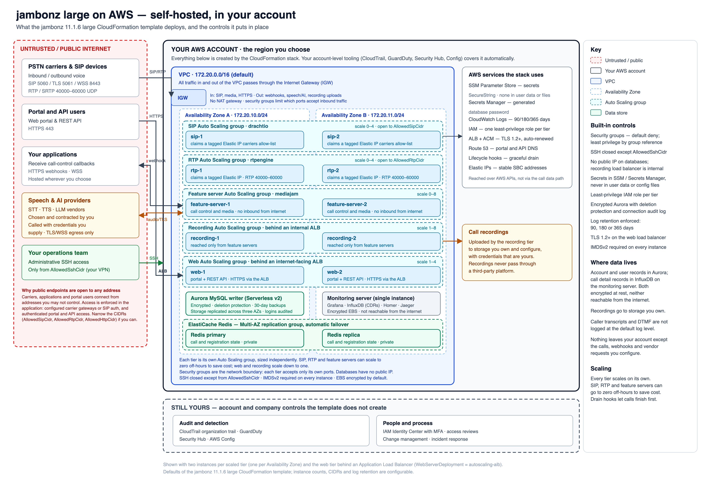
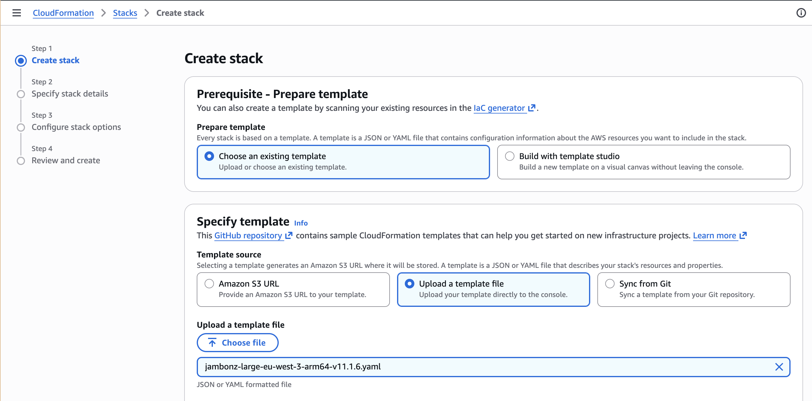
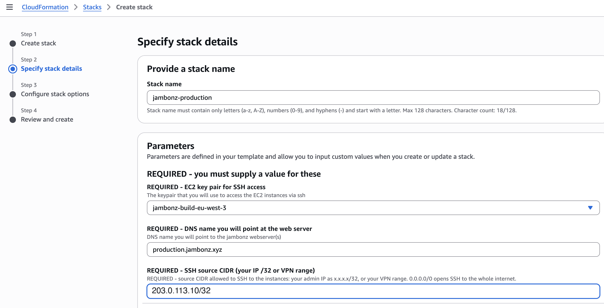
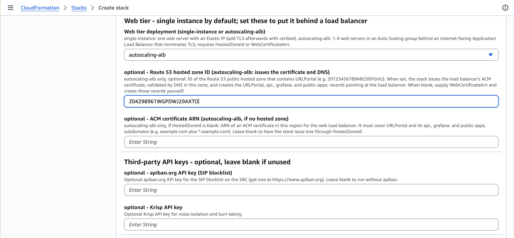
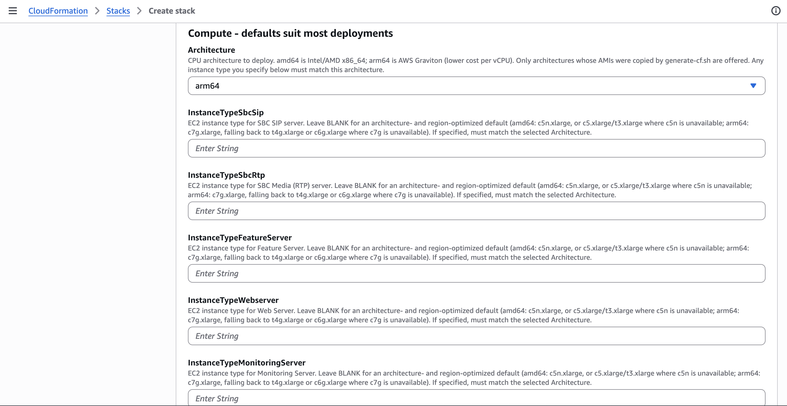
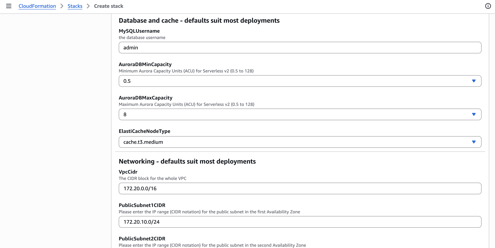
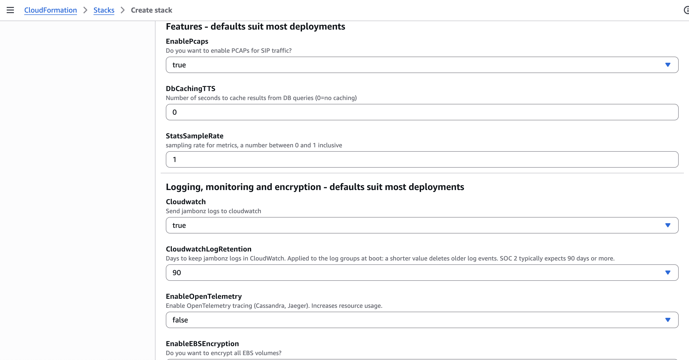
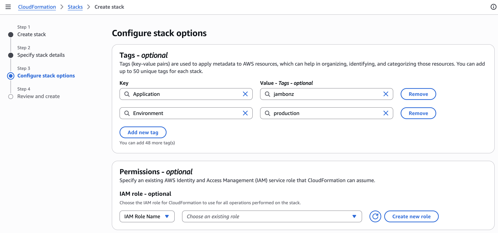
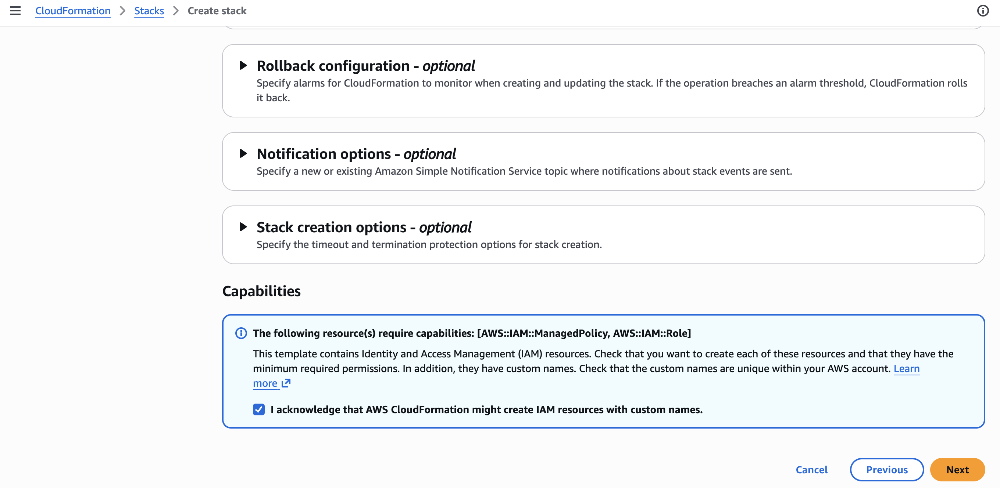
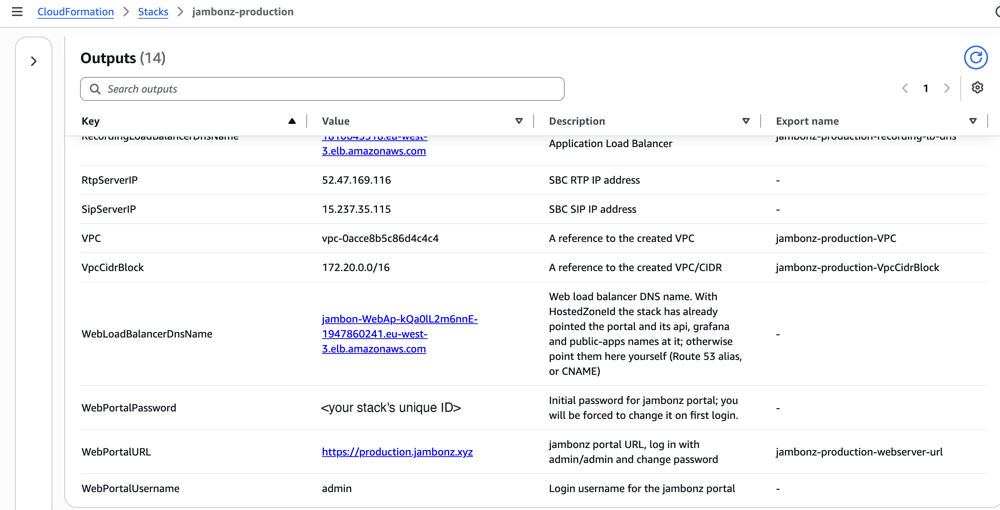

## Key Takeaways

- **Self-hosting alone doesn't make Voice AI SOC 2-ready:** Frameworks that leave secrets handling, IAM roles, encryption, and log retention to you put the audit burden on your team. jambonz 11.1.6 ships those controls built in.
- **Your data stays in your own AWS account:** Recordings, transcripts, and call records live inside a VPC you control, covered by the security tooling you already use (CloudTrail, GuardDuty, Security Hub).
- **Deployment is a CloudFormation template away, but some controls remain yours:** The template handles infrastructure controls like encryption, least-privilege roles, and 90-day log retention. Your policies, people's access, and account-wide logging are still yours to put in place.

In the unfolding age of AI-powered cybersecurity threats, hardening your IT infrastructure is more important than ever, and [Voice AI orchestration platforms](https://jambonz.org/) present specific challenges.  By their nature, these systems are heavily connected to the outside world: 
- They need to allow SIP, RTP and HTTP traffic in, and 
- They need to connect out to services such as LLM and speech processing platforms.  

Furthermore, Voice AI platforms house significant amounts of private customer data that attract cyber criminals: phone numbers, personally-identifiable information, private credentials, transcripts, audio recordings, and more.

At jambonz, we've spent a lot of time, energy, and resources over the past year to harden and protect our cloud systems as part of an effort to achieve SOC-2 attestation.  We've learned a lot, factored that learning into the suite of self-hosted deployment tools that we provide our customers, and this blog post describes how to [build your own self-hosted jambonz cluster on AWS](https://docs.jambonz.org/self-hosting/overview) that is also ready for a SOC-2 audit.

## What Is SOC 2?

SOC 2 is a security framework that specifies how organizations should protect customer data from unauthorized access, security incidents, and other vulnerabilities.  The [American Institute of Certified Public Accountants (AICPA)](https://www.aicpa-cima.com/resources/download/2017-trust-services-criteria-with-revised-points-of-focus-2022) developed SOC 2 around five Trust Services Criteria: **security, availability, processing integrity, confidentiality, and privacy**.  Once your system has been appropriately hardened and ready, an independent auditor examines your security controls and writes a report saying whether those controls exist and whether they work. The report is organized around five Trust Services Criteria:

- **Security:** systems are protected against unauthorized access. This is the one every SOC 2 report covers.
- **Availability:** systems are up and recoverable as promised.
- **Processing integrity:** systems do what they are supposed to, completely and accurately.
- **Confidentiality:** information marked confidential stays that way.
- **Privacy:** personal information is collected, used and disposed of properly.

There are two kinds of report. A **Type I** report looks at whether your controls are designed properly at a single point in time. A **Type II** report looks at whether they actually operated in accordance with your policies over a period of time, usually three months or so.

Why has SOC 2 gone from "nice to have" to "no report, no contract"? Because attacks have become routine, and the costliest ones increasingly come through vendors. A bank can harden its own systems and still be exposed through the contact-center software that records its customers' calls. Vendor-risk teams have learned this the hard way. A SOC 2 report is how they decide whether you are a risk they can take on.

Voice AI raises the stakes. A [conversational agent](https://docs.jambonz.org/verbs/verbs/agent) doesn't just route calls. It also [listens](https://docs.jambonz.org/verbs/verbs/listen), [transcribes](https://docs.jambonz.org/verbs/verbs/transcribe), sends what it hears to speech and language models, and often looks up the caller's records during a call. That is a lot of sensitive data moving through a lot of systems, and it all has to be thoughtfully secured end-to-end. That is what SOC-2 is designed to report on.

## Where Does Your Customers' Data Live?

For many teams a hosted platform is the right call. It’s the fastest way to get a voice agent into production, and that's why we run jambonz.cloud.

But many organizations need ultimate control over their customer and call data, whether for data sovereignty or for strict privacy and security requirements: banks, health systems, public-sector agencies, and companies bound to keep data in a specific country. For them, self-hosting is the answer. 

Our jambonz self-hosted runs in your own AWS account, in the region you choose, inside a VPC you own, behind your security groups, under your IAM policies, and logging to your CloudWatch. Recordings, transcripts and call records never leave the boundary you control and audit. Because it runs in your account, the security tooling you already use covers it too: GuardDuty threat detection, CloudTrail auditing, Security Hub and AWS Config apply to jambonz like any other workload, with no extra integration.

Self-hosting by itself isn’t enough, though. Developer frameworks such as LiveKit can be self-hosted, but they give you building blocks and leave the hardening to you: secrets handling, IAM roles, database encryption, log retention, network rules. That work is where audits are won or lost. With jambonz 11.1.6 on AWS, that hardening ships as part of the product.

## 16 Takeaways From Our SOC 2 Journey

We run jambonz ourselves as a hosted service, jambonz.cloud. Going through SOC 2 readiness on our own infrastructure taught us a lot that we have now factored into our self-hosted deployment scripts.

We were in decent shape to start with because we have always focused on security and privacy: our customers span the globe and often have have chosen to self-host for security and data residency requirements as well as latency.

For example, we designed our call recording feature such that we never store the call audio on any of our systems; instead we stream it to the customer's own cloud storage, specifically for privacy reasons. Additionally, we've always encrypted private credentials such as access tokens or api keys with the latest crypto techniques - and then stored the encrypted hashes in a database that itself is encrypted. And so on.

Nonetheless, we learned a lot during our SOC-2 preparedness, and we've factored all of this into jambonz release 11.1.6 and then updated our [AWS Cloudformation scripts](https://github.com/jambonz-selfhosting/cloudformation) to make it available to you. Here are some of the important changes that our 11.1.6 deployments on AWS now have:

- **Caller transcripts and DTMF digits are no longer logged at `info` level.** They appear only at `debug`, which a customer can choose to turn on briefly to troubleshoot, not in normal operation. That keeps what callers say, and the digits they key in (account numbers, PINs, dates of birth), out of the systems log files.
- **Every secret lives in AWS Systems Manager Parameter Store** as an encrypted SecureString.  No secrets appear in plaintext in any config file or anywhere on disk of any of your EC2 instances.
- **Least-privilege instance roles:** each server tier gets only the IAM permissions its software actually requires.
- **Fewer ports open to the internet.** We eliminated the dependency on SNS for ScaleIn notifications which allowed us to remove an open port from the security groups.  We also removed ports that were open but unused for SMPP.
- **The instance metadata service requires IMDSv2** on every server, which blocks a common way of stealing instance credentials.
- **No default credentials:** new installs generate a random admin API token and the portal's initial password is unique to each deployment, and you must change it the first time you sign in.
- **SSH is closed by default.** There is no default source CIDR. You must name your admin IP or VPN range.
- **The database is encrypted and protected:** Aurora is encrypted at rest, with 30 days of backups, deletion protection, and a final snapshot if the stack is ever deleted. Database logins, logouts and failed logins are logged to CloudWatch.
- **Log retention is enforced:** 90 days by default, with 180 or 365 available.
- **Redis survives an availability-zone failure:** it runs as two nodes in separate zones with automatic failover.
- **TLS everywhere public:** the web tier can now autoscale and can sit behind an AWS Application Load Balancer (ALB) that terminates TLS 1.2 and 1.3, with the certificate issued and renewed by AWS. SIP over TLS and WSS are enabled automatically when you store a certificate in Parameter Store.
- **Credentials for [listen](https://docs.jambonz.org/verbs/verbs/listen) websockets are never written to the logs**, at any level.
- **Per-account API rate limits:** limits on call creation, call status reads, sign-in and sign-up, returning `429` when a client exceeds them.
- **Tighter permissions:** service-provider users can no longer change operator-only settings, carrier changes stay within the user's own organization or account, and calls from a registration trunk's address match only carriers that belong to the right account.
- **Control over support audio capture:** When VoIPMonitor is used in conjuntion with jambonz for troubleshooting pruposes, accounts and organizations can opt out of having their audio collected for this purpose by making a selection on the jambonz portal.
- **PCI-compliant credit card processing:** When using a third-party service like [PCIPal](https://www.pcipal.com/) to collect and process credit card payments, [jambonz can remove iself from the media path](https://docs.jambonz.org/guides/features/managing-media-anchors) during the credit card portion of the transaction.

## Walkthrough: Deploying a SOC 2-ready Cluster on AWS

Here's the whole process, start to finish, for a **jambonz large** deployment on AWS. In a large deployment every role (SIP, media, feature servers, web, monitoring, recording) runs on its own servers, and the SIP, media, feature server, web and recording tiers each scale in their own Auto Scaling group. It's the size we recommend for production in regulated environments.



### Step 1: Generate the Template for Your Region

jambonz images are published as public AMIs. A short script copies them into your own AWS account, encrypts the underlying volumes, and then writes a CloudFormation template with the proper AMI mappings for your region. Clone the [jambonz CloudFormation repository](https://github.com/jambonz-selfhosting/cloudformation) and run:

```bash
./generate-cf.sh
```

The script asks for three things: the deployment size (choose **large**), the CPU architecture (we support both amd64 and arm64 (Graviton processors), and your AWS region. It then copies the AMIs, which takes 5 to 15 minutes, and finally generates a Cloudformation file such as `jambonz-large-eu-west-3-arm64-v11.1.6.yaml`.

### Step 2: Upload the Template

In the AWS console, go to **CloudFormation → Create stack**. Choose **Upload a template file**, and pick the file the script wrote.



### Step 3: The Required Parameters

Give the stack a name, then fill in the three values the template requires.



- **EC2 key pair:** the SSH key for reaching the servers.
- **DNS name for the web server:** the hostname for your jambonz portal, for example `voice.example.com`.
- **SSH source CIDR:** the one address range allowed to SSH to any server. Use your admin IP as a `/32`, or your VPN's range. There is no default on purpose.

> **SOC 2:** the SSH CIDR is your logical access control at the network level (criteria [CC6.1](#cc6-1) and [CC6.6](#cc6-6)). An auditor will look for administrative access limited to known sources. If you enter `0.0.0.0/0` here, you open SSH to the whole internet, and you'll have to explain why.

### Step 4: The Web Tier



Set **Web tier deployment** to `autoscaling-alb`. This runs one to four web servers in an Auto Scaling group behind an Application Load Balancer that terminates TLS.

If your domain is in Route 53, enter its **hosted zone ID**. The stack then issues the TLS certificate through AWS Certificate Manager, validates it, and creates the DNS records for the portal and the API. If your DNS lives elsewhere, leave the zone blank and supply an ACM certificate ARN instead.

The **third-party API keys** below are optional. Leave a key blank if you don't use the service. Any key you do enter is hidden in the console and stored in Parameter Store, not on the servers' disks.

> **SOC 2:** the load balancer enforces TLS 1.2 or higher, with a certificate AWS renews automatically. That covers encryption in transit for the portal and the API ([CC6.7](#cc6-7)), and it removes an expired certificate as a cause of an outage or a finding.

### Step 5: Compute



Choose `amd64` or `arm64` (AWS Graviton, lower cost per vCPU) to match the AMIs you copied. Leave the instance types blank to get defaults suited to your architecture and region. There's nothing audit-specific here; size for your call volume.

### Step 6: Database, Cache and Networking



The defaults suit most deployments. Aurora Serverless v2 scales between the minimum and maximum capacity you set here. Notice what you *don't* enter: a database password. The stack generates one and stores it in Secrets Manager, so no person ever has to see it.

The VPC and subnet ranges only matter if this VPC must connect to your existing networks without overlapping.

> **SOC 2:** the database is encrypted at rest, keeps 30 days of backups, can't be deleted by accident, and logs every connection attempt. Those settings are fixed in the template, not offered as parameters, so nobody can turn them off by mistake. They support confidentiality ([C1.1](#c1-1)), your backup and recovery evidence ([A1.2](#a1-2)), and monitoring ([CC7.2](#cc7-2)).

### Step 7: Features, Logging, Monitoring and Encryption



This group holds the settings an auditor will care about most:

- **EnablePcaps:** captures SIP signaling for troubleshooting in the portal's Recent Calls view. SIP messages contain phone numbers, so decide whether you need it. Most teams keep it, because diagnosing call failures without it is slow.
- **Cloudwatch:** keep it `true`. Your application logs go to CloudWatch in your own account.
- **CloudwatchLogRetention:** the default is `90` days, and most SOC 2 auditors expect at least that. Choose `365` if your policies require a full year. The retention is applied when the servers boot.
- **EnableOpenTelemetry:** leave it `false` unless you need distributed tracing. Traces are another copy of call details, and a copy you don't make is one you don't have to protect.
- **EnableEBSEncryption:** below the edge of this screenshot, defaulting to `true`. Keep it. Every disk in the cluster is then encrypted at rest.

> **SOC 2:** retained, centralized logs are the evidence an auditor samples to confirm you monitor your systems ([CC7.2](#cc7-2)). Encrypted disks cover data at rest ([CC6.1](#cc6-1)). Keep in mind that the application logs no longer contain caller transcripts at the default log level. Leave the log level at `info` in production, and turn on debug logging for an account only for as long as a support case needs it.

### Step 8: Tags and Permissions



Add tags such as `Application=jambonz` and `Environment=production`. CloudFormation applies them to the resources it creates. This is an optional step, but it gives you an asset inventory you can filter on, which is another thing auditors ask for.



At the bottom of the page, acknowledge that the stack creates IAM resources. These are the least-privilege roles for each server tier. Each grants only the API calls that tier's software makes, such as reading its own parameters from Parameter Store or completing an Auto Scaling lifecycle action. Review them in IAM after the stack is up. An auditor may ask you to show that no server holds broader access than it needs ([CC6.3](#cc6-3)).

Then click **Next**, review, and **Submit**. You can follow progress on the stack's **Events** tab.

### Step 9: Outputs and First Sign-in



When the stack finishes, the **Outputs** tab lists the portal URL, the SBC addresses to give your carriers, and the portal's initial password. That password is the stack's unique ID, so it differs for every deployment. You must change it the first time you sign in.

### After The Stack Is Up

A few steps finish the job:

1. **Sign in and change the admin password.** The portal requires it.
2. **Activate your jambonz license** ([licensing.jambonz.org](https://licensing.jambonz.org)).
3. **Turn on SIP over TLS**, if your carriers or SIP clients support it. Store your certificate in Parameter Store as `TLS_PRIVKEY`, `TLS_CERT` and `TLS_CHAIN` under `/jambonz/<stack>/sbc`. Each SBC enables TLS on port 5061 and WSS on port 8443 when it boots.
4. **Narrow the SIP and RTP source ranges** to your carriers' addresses if you know them. The template's `AllowedSipCidr`, `AllowedRtpCidr` and `AllowedHttpCidr` parameters default to open, because most deployments take calls from many sources.
5. **Restrict who can read `/jambonz/<stack>/` in Parameter Store.** The servers can read their own secrets; your people should need a reason to.

## What You Still Need to Do for SOC 2 Compliance

A CloudFormation template can harden a deployment. It can't run your security program. These controls sit at the AWS account or company level, and an auditor will ask about them too:

- **CloudTrail**, with an organization trail writing to a locked-down S3 bucket, so every API call in the account is recorded.
- **Human access through IAM Identity Center** (or your identity provider), with MFA, rather than long-lived IAM users.
- **Change management:** how stack updates are reviewed and approved.
- **Written policies:** access reviews, incident response, vendor management, backup testing.

That list is shorter than it would be if you were also building the voice platform's controls yourself. That's the point.

## Get Started with a SOC 2-Ready Self-Hosted Voice AI Platform on AWS

jambonz 11.1.6 is available now as public AMIs in 30 AWS regions, for both amd64 and arm64, and as Debian packages. Start with the [AWS self-hosting guide](https://docs.jambonz.org/self-hosting/hosting-providers/aws), or [talk to us](https://jambonz.org) about running jambonz in your environment. If you're preparing for an audit of your own, we're happy to compare notes.

## SOC 2 Criteria Referenced in This Guide

SOC 2 reports test controls against the AICPA's Trust Services Criteria. Every SOC 2 report covers the Security category, also called the common criteria (the "CC" codes). Availability and Confidentiality are optional categories that you choose to include. The summaries below are our own wording. The official text is in the AICPA's [2017 Trust Services Criteria (With Revised Points of Focus – 2022)](https://www.aicpa-cima.com/resources/download/2017-trust-services-criteria-with-revised-points-of-focus-2022), a free download that requires an AICPA account.

- <a id="cc6-1"></a>**CC6.1** (Security): logical access controls, such as restricting and authenticating access and encrypting stored data, protect information assets.
- <a id="cc6-3"></a>**CC6.3** (Security): access to data and systems is granted, changed and removed according to people's roles, following least privilege and separation of duties.
- <a id="cc6-6"></a>**CC6.6** (Security): access controls protect the system from threats that originate outside its boundaries, for example by limiting which external sources can connect.
- <a id="cc6-7"></a>**CC6.7** (Security): moving and transmitting information is limited to authorized users and processes, and information is protected in transit.
- <a id="cc7-2"></a>**CC7.2** (Security): system components are monitored for anomalies that could indicate attacks, errors or failures, and those anomalies are analyzed to find security events.
- <a id="a1-2"></a>**A1.2** (Availability): backups, recovery infrastructure and environmental protections are put in place, operated and monitored to meet availability commitments.
- <a id="c1-1"></a>**C1.1** (Confidentiality): confidential information is identified and kept protected to meet confidentiality commitments.
